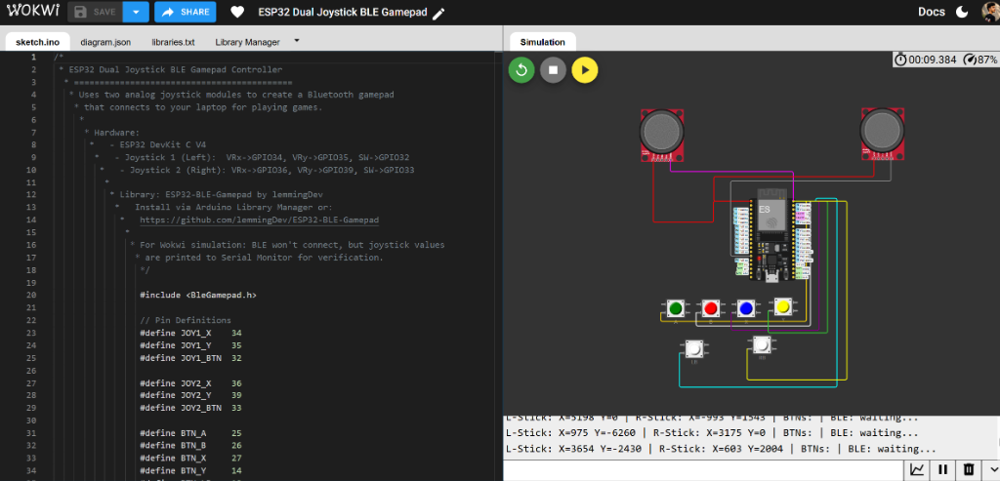

# 🎮 ESP32 Dual Joystick BLE Gamepad Controller

A DIY Bluetooth gaming controller built with an ESP32 and two analog joystick modules. Connects to your PC/laptop as a standard BLE gamepad for playing games.

## 🛠️ Hardware Required

| # | Component | Qty | Est. Price (INR) |
|---|-----------|:---:|:-----------------:|
| 1 | ESP32 DevKit C V4 | 1 | ₹350-500 |
| 2 | Analog Joystick Module (KY-023) | 2 | ₹60-80 each |
| 3 | Push Buttons (optional) | 6 | ₹5-10 each |
| 4 | Breadboard (830 point) | 1 | ₹80-120 |
| 5 | Jumper Wires (M-M, M-F) | ~20 | ₹50-80 |
| 6 | Micro USB Cable | 1 | ₹50-100 |
| | **Total** | | **₹650-1000** |

## 📌 Pin Connections

### Left Joystick (Joystick 1)
| Joystick Pin | ESP32 Pin | Function |
|:---:|:---:|---|
| VRx | GPIO 34 | Left/Right axis |
| VRy | GPIO 35 | Up/Down axis |
| SW | GPIO 32 | L3 (stick click) |
| VCC | 3.3V | Power |
| GND | GND | Ground |

### Right Joystick (Joystick 2)
| Joystick Pin | ESP32 Pin | Function |
|:---:|:---:|---|
| VRx | GPIO 36 (VP) | Left/Right axis |
| VRy | GPIO 39 (VN) | Up/Down axis |
| SW | GPIO 33 | R3 (stick click) |
| VCC | 3.3V | Power |
| GND | GND | Ground |

### Extra Buttons (Optional)
| Button | ESP32 Pin | Gamepad Button |
|:---:|:---:|---|
| A | GPIO 25 | South / Cross |
| B | GPIO 26 | East / Circle |
| X | GPIO 27 | West / Square |
| Y | GPIO 14 | North / Triangle |
| LB | GPIO 12 | Left Bumper (L1) |
| RB | GPIO 13 | Right Bumper (R1) |

> All buttons connect one leg to the ESP32 GPIO pin and the other to GND. Internal pull-up resistors are used.

## 🚀 Getting Started

### Wokwi Simulation (Online)
👉 **[Open Live Wokwi Simulation](https://wokwi.com/projects/481663815455567873)**

1. Open the [Wokwi Simulation Project](https://wokwi.com/projects/481663815455567873)
2. Hit ▶ Play — move joysticks and watch Serial Monitor

### Real Hardware (Arduino IDE)
1. Install [Arduino IDE](https://www.arduino.cc/en/software)
2. Add ESP32 board package:
   - File → Preferences → Additional Board URLs: `https://dl.espressif.com/dl/package_esp32_index.json`
   - Tools → Board → Boards Manager → Search "esp32" → Install
3. Install `ESP32-BLE-Gamepad` library via Library Manager
4. Select board: `ESP32 Dev Module`
5. Upload `sketch.ino`
6. On your laptop: Bluetooth Settings → Pair **"ESP32 Dual Gamepad"**
7. Test at [gamepad-tester.com](https://gamepad-tester.com)
8. Play games! 🎮

## 📁 Project Files

| File | Description |
|------|-------------|
| `sketch.ino` | Main ESP32 firmware (BLE Gamepad + joystick reading) |
| `diagram.json` | Wokwi circuit layout (paste in simulator) |
| `wokwi-simulation.png` | Screenshot of the Wokwi circuit simulation |

## 🎯 Features

- ✅ **Dual analog joysticks** — full left/right stick control
- ✅ **8 buttons** — A, B, X, Y, LB, RB, L3, R3
- ✅ **BLE Gamepad** — appears as standard Xbox controller on Windows/Mac/Linux
- ✅ **Deadzone calibration** — configurable dead zone for precise control
- ✅ **100Hz polling** — responsive, low-latency input
- ✅ **Serial debug** — real-time axis & button monitoring

## 📄 License

MIT License — feel free to use, modify, and share!

---

Made with ❤️ using ESP32 + Arduino
